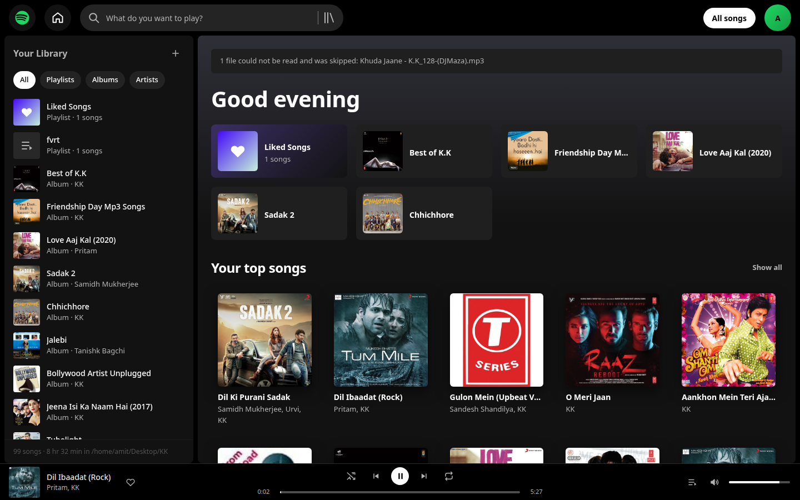
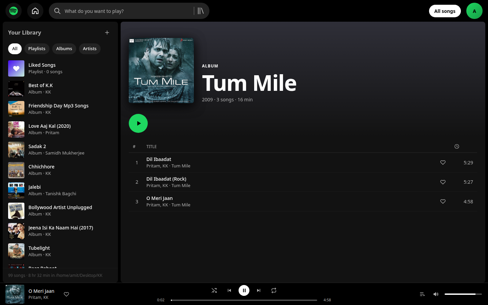
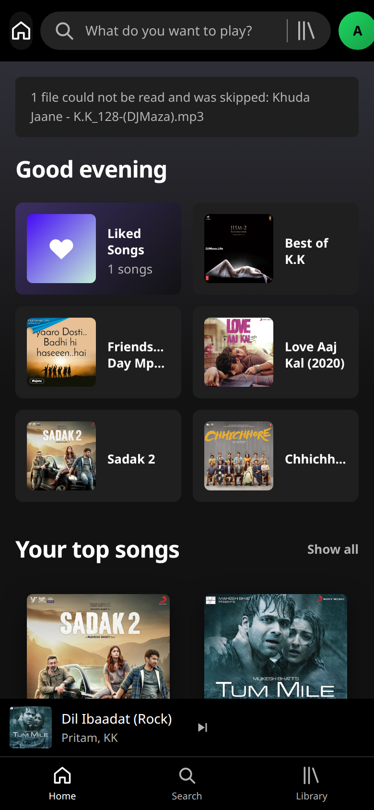
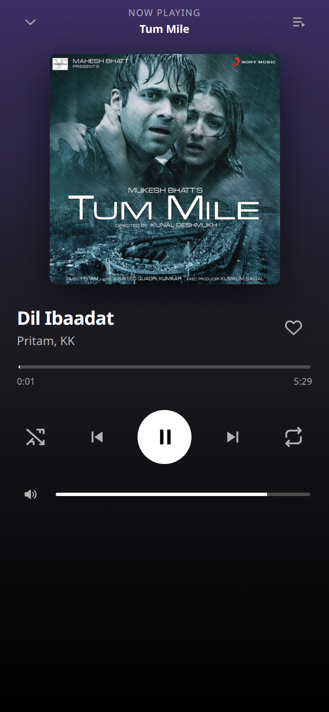
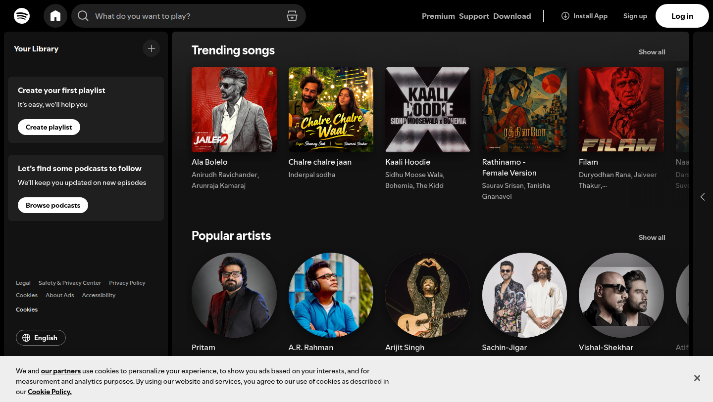

<div align="center">

# KKfy

### A Spotify-shaped player for the MP3s on this laptop

**Zero dependencies · four files of code · desktop and phone**

[](#-quick-start)
[](#-quick-start)




</div>

---

## Table of contents

- [Features](#-features)
- [Quick start](#-quick-start)
- [Screenshots](#-screenshots)
- [Built by measuring the real Spotify](#-built-by-measuring-the-real-spotify)
- [Architecture](#-architecture)
- [HTTP contract](#-http-contract)
- [Why Range requests matter](#-why-range-requests-matter)
- [Cleaning tag junk](#-cleaning-tag-junk)
- [Keyboard shortcuts](#-keyboard-shortcuts)
- [Phone layout](#-phone-layout)
- [Project structure](#-project-structure)
- [Troubleshooting](#-troubleshooting)
- [About the music files](#-about-the-music-files)
- [License](#-license)

---

## Features

| | |
|---|---|
| **Real playback** | HTTP `206 Partial Content` streaming, so jumping to 3:00 is instant |
| **Real album art** | cover art lifted out of each MP3's ID3 `APIC` frame |
| **Honest metadata** | `ffprobe` tags plus a filename fallback; site junk stripped from every field |
| **Liked songs** | one heart button - server-backed locally, `localStorage` when hosted |
| **Library** | albums, artists, playlists you create, filter chips, instant search |
| **Transport** | shuffle, repeat off/all/one, queue drawer, volume, 3-second "previous" rule |
| **Made for the phone** | bottom tab bar, library drawer, full-screen Now Playing sheet |
| **It remembers** | last song, volume, likes, playlists and play counts survive a reload |
| **Honest about failures** | the one broken MP3 in the folder is reported, not hidden |

---

## Quick start

**1. Run it locally (full server, real Range streaming):**

```bash
node server.mjs
# KKfy ready  ->  http://127.0.0.1:7770   (99 songs, 512 min)
```

**2. Build it as static files (what Vercel serves):**

```bash
node scripts/build-static.mjs   # writes public/library.json + public/covers/
npx serve public                 # or any static file server
```

**3. What is in this repository:**

```
public/
  index.html  app.css  app.js  icons.js   the whole UI
  library.json                            the scanned library
  covers/*.jpg                            98 cover images
  KK/*.mp3                                the 100 songs
server.mjs   lib/scan.mjs   scripts/      the local server + scanner
```

Both modes share one bundle of front-end code. At boot the app asks for
`/api/library` first and falls back to `/library.json`, which is how it knows
whether it is talking to the Node server or a static CDN.

---

## Screenshots

| Desktop | Album + queue |
|---|---|
|  |  |

| Phone home | Now Playing sheet |
|---|---|
|  |  |

---

## Built by measuring the real Spotify

Instead of guessing how Spotify looks, REA (Reverse Engineer Anything) attached to a
headless Chrome through the DevTools protocol and reported the DOM, the accessibility
tree and the computed styles of `open.spotify.com`.

```js
tools.rea.list_browser_targets({ cdp_endpoint: "http://127.0.0.1:9333" })
tools.rea.inspect_web_page({ target_id, include_accessibility_text: true })
tools.rea.capture_web_screenshot({ target_id })
```

### Measured, not assumed

| What REA reported | Where it went into KKfy |
|---|---|
| `--background-base:#121212`, `--background-highlight:#1f1f1f`, `--background-press:#000` | the three background tokens |
| `--text-base:#fff`, `--text-subdued:#b3b3b3` | text and secondary text |
| `--essential-bright-accent:#1ed760` | the green accent |
| now-playing bar is **66 px** tall | `--player: 66px` |
| main content starts at `y = 64` | `--topbar: 64px` |
| play button `border-radius: 9999px` | every circular control |
| font stack `SpotifyMixUI, CircularSp-*, Helvetica Neue` | the `font:` rule, minus the proprietary faces |

### The accessibility tree gave the real structure

```
complementary | Now playing bar
navigation    | Main
heading       | Your Library
  button      | Create
  combobox    | What do you want to play?
  button      | Enable shuffle
  button      | Previous
  button      | Pause
  button      | Next
  checkbox    | Disable repeat
  slider      | Change progress
  slider      | Change volume
```

Those exact strings became the `title` and `aria-label` of every control in KKfy.



---

## Architecture

```
   browser  (desktop or phone)
      |
      |  GET /                    index.html + css + js
      |  GET /library.json        the whole library index, one JSON blob
      |  GET /KK/<song>.mp3       the audio  --> CDN answers Range requests
      |  GET /covers/<id>.jpg     cover art
      |  localStorage             likes, playlists, volume, play counts
      |
      |  ---- local mode only ----
      |  GET|PUT /api/state       server-backed state
      |  GET      /api/stream/:id same files, served by node with Range
      |  POST     /api/play       play counters
      v
   server.mjs  (node:http, zero dependencies)
      |-- data/library.json    cached scan
      |-- data/covers/*.jpg    art extracted once with ffmpeg
      |-- data/userstate.json  what you liked / created / last played
      |-- data/stats.json      play counts -> "Your top songs"
      v
   ~/Desktop/KK/*.mp3   read-only, never modified
```

---

## HTTP contract

| Route | Method | What it does |
|---|---|---|
| `/api/library`, `/library.json` | GET | `{ tracks[], albums[], skipped[], totalSeconds }` |
| `/api/stream/:id`, `/KK/<file>` | GET | the MP3 with `Range` support |
| `/api/cover/:id`, `/covers/<id>.jpg` | GET | cover art from the ID3 `APIC` frame |
| `/api/state` | GET/PUT | likes, playlists, volume, shuffle, repeat |
| `/api/play` | POST | `{ id }` bumps the play counter |
| `/api/stats` | GET | `{ [trackId]: { plays, lastPlayed } }` |
| `/api/rescan` | POST | rebuild the index from disk |

```console
$ curl -s -H "Range: bytes=0-999" -D - http://127.0.0.1:7770/api/stream/4c3054684572 | grep -Ei "HTTP/|content-range"
HTTP/1.1 206 Partial Content
content-range: bytes 0-999/4783068

$ curl -s -H "Range: bytes=999999999-" -o /dev/null -w "%{http_code}\n" http://127.0.0.1:7770/api/stream/4c3054684572
416
```

---

## Why Range requests matter

An MP3 here is 3-14 MB. Answer `200 OK` with the whole file and the browser cannot
jump to 3:00 until everything has downloaded. Answer `206 Partial Content` and it
asks for exactly the bytes under the playhead.

```
   client                              server
      |  GET /KK/song.mp3                |
      |  Range: bytes=1000000-2000000    |
      |--------------------------------->|
      |                                  |  clamp end to size-1
      |  206 Partial Content             |  read bytes 1000000..2000000
      |  Content-Range: bytes 1000000-2000000/4783068
      |<---------------------------------|
      |  ... seek again -> another 206
```

Ask for bytes past the end and you must answer **416** with `Content-Range: bytes */size`,
or the browser retries forever.

---

## Cleaning tag junk

Every file in this folder was downloaded from a site that writes its own name into
eight ID3 fields. `clean()` removes that noise. Each row below is a real value from
this library:

| Raw tag | After `clean()` |
|---|---|
| `Aankhon Mein Teri Ajab Si - JioSongs.com` | `Aankhon Mein Teri Ajab Si` |
| `Abhi Abhi - KK_128-(DJMaza)` | `Abhi Abhi` |
| `Aaya Re Koyi Dil Ko Churaane - www.hotmentos.com` | `Aaya Re Koyi Dil Ko Churaane` |
| `Tujhi Mein [320 kbps]` | `Tujhi Mein` |
| `09 - Hum Rahe Ya Na Rahe By..kk (Mp3wale.com)` | `Hum Rahe Ya Na Rahe` |
| `Best of K.K - www.DJMaza.Live` | `Best of K.K` |
| `Life In A Metro` | `Life In A Metro` - untouched |

Two rules earn their keep:

- **Domains only, never bare words.** The first version treated `in` as the `.in`
  TLD and turned `Life In A Metro` into `Life A Metro` and `Main Khuda` into
  `Ma Khuda`. The regex now insists on a dot: `[a-z0-9-]+\.(?:com|in|net|...)`.
- **Ripped tags get swapped back.** Some files put the movie in `album` and `KK` in
  `artist`, or the reverse; a compilation keeps `Song - Movie` inside the title.
  Both cases are detected and repaired.

The one unreadable file is reported instead of hidden:

```json
"skipped": [{ "file": "Khuda Jaane - K.K_128-(DJMaza).mp3", "reason": "empty file (0 bytes)" }]
```

---

## Keyboard shortcuts

| Key | Action | Key | Action |
|---|---|---|---|
| `Space` | play / pause | `L` | like the current song |
| `←` / `→` | seek -5 s / +5 s | `S` | shuffle on / off |
| `↑` / `↓` | volume +/- 5 % | `R` | repeat off - all - one |
| `N` / `P` | next / previous | `M` | mute |
| `Q` | toggle the queue | `/` | jump to search |
| `A` | add current song to a playlist | `Esc` | close queue, sheet or drawer |

The 3-second rule: pressing previous inside the first three seconds goes to the
previous track, after that it restarts the current one - same as Spotify.

---

## Phone layout

At 820 px and below the three desktop regions re-flow instead of shrinking:

| Desktop | Phone |
|---|---|
| Library rail on the left | slide-in drawer, opened by the Library tab |
| Full transport in the bar | compact strip: cover, title, next - tap to expand |
| Shuffle / repeat / volume visible | full controls in the Now Playing sheet |
| - | bottom tab bar with `env(safe-area-inset-bottom)` padding |

Touch targets stay at 44 px or more, and the sheet animates with a transform
(`translateY(100%)` to `none`) so opening it costs no layout.

---

## Project structure

```
kkfy/
├── public/                 <- what a static host serves
│   ├── index.html          frame: top bar, sidebar, main, player, queue, sheet
│   ├── app.css             Spotify tokens, grid, player, phone layout
│   ├── app.js              state, hash router, rendering, the <audio> engine
│   ├── icons.js            inline SVG glyphs
│   ├── library.json        generated by scripts/build-static.mjs
│   ├── covers/*.jpg        generated (98 files)
│   └── KK/*.mp3            the music
├── lib/scan.mjs            ffprobe + ffmpeg: tags, duration, cover art, junk cleaning
├── scripts/build-static.mjs  library.json + covers for the static build
├── server.mjs              node:http server: /api/*, Range streaming, state
├── data/                   local cache only (gitignored)
├── vercel.json             outputDirectory, Range and cache headers
└── docs/screens/           screenshots, including the Spotify reference
```

### Verified, running

```
album: Best of K.K
tracks in album: 12
engine: {"paused":false,"dur":301.36,"src":"Beete%20Lamhe%20-%20KK_128-(DJMaza).mp3"}
currentTime over 2.0s: 2.96s -> 4.97s   (advanced 2.00s)
```

---

## Troubleshooting

| Symptom | Cause | Fix |
|---|---|---|
| `EADDRINUSE` on 7770 | another copy is running | `pkill -f server.mjs` or `KKFY_PORT=7780 node server.mjs` |
| Song starts, no sound | browser autoplay policy | click a track once - that click is the gesture |
| New files missing | cached index | `curl -X POST localhost:7770/api/rescan` |
| `ffprobe: not found` | the scanner needs ffmpeg | `sudo apt install ffmpeg` |
| No cover art | the file has no embedded picture | the card falls back to a disc glyph |
| Static build is stale | files changed on disk | `node scripts/build-static.mjs` |

Point it somewhere else:

```bash
KKFY_MUSIC="/path/to/other/library" KKFY_PORT=7780 node server.mjs
```

---

## About the music files

`public/KK/` holds 100 MP3 files that were downloaded from music sites and kept for
personal listening. They are the author's own collection, included so the project
runs out of the box. They are **not** licensed for redistribution, and the code in
this repository claims no rights over them. The songs belong to their artists,
labels and publishers; delete the folder to run KKfy against your own music.

---

## License

The code is MIT. See [LICENSE](LICENSE).

Music, cover art and any third-party marks remain the property of their owners.


